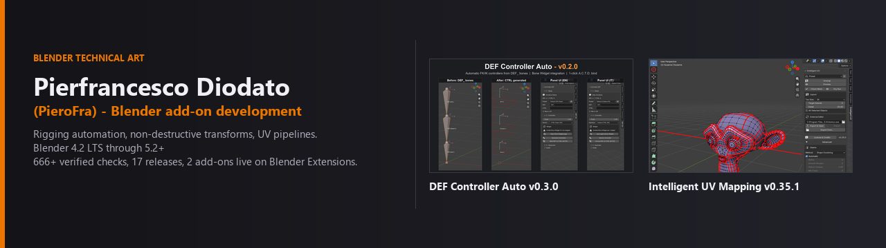
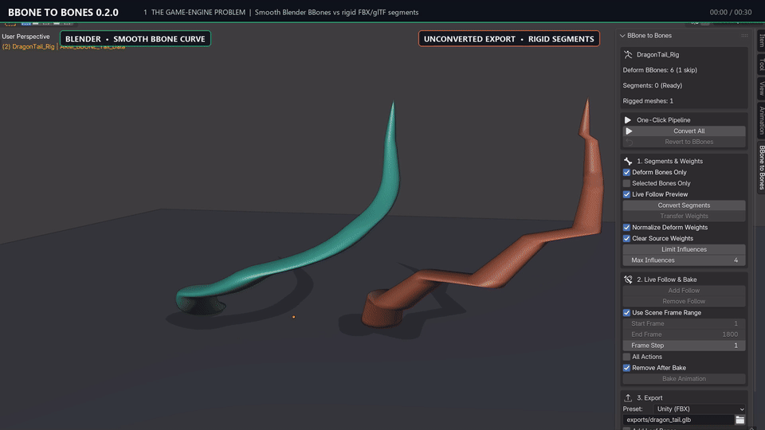

# Pierfrancesco Diodato (`PieroFra`)

> **I build production-ready Blender tools that make rigging and UV workflows faster, safer and reversible.**

CS & Game Dev Student | Aspiring Technical Artist & Blender Add-on Developer focused on rigging automation, non-destructive deformation workflows, and UV pipelines for Blender 4.2 LTS through 5.2+.

**Featured project: BBone to Bones (`v0.1.0`)**  
Convert Blender Bendy Bones (`bbone_segments > 1`) into game-ready bone chains (`<name>_seg_00..XX`) with curved joint boundary blending (`< 0.001 m`), one-click deform-only influence cap, non-destructive `Revert to BBones`, and 5 engine export presets (`UNITY`, `UNITY_GLTF`, `UNREAL`, `UNREAL_GLTF`, `GODOT`).  
[Watch the live GIF demo](#bbone-to-bones-bendy-bones-to-game-ready-chains) | [Direct GIF](https://raw.githubusercontent.com/PieroFra/PieroFra/main/assets/bbone_to_bones_demo_v3.gif) | [1080p 60fps MP4 video](https://raw.githubusercontent.com/PieroFra/PieroFra/main/assets/bbone_showcase_1080p.mp4) | [GitHub Release v0.1.0](https://github.com/PieroFra/bbone-to-bones/releases/tag/v0.1.0) | [Documentation](https://github.com/PieroFra/bbone-to-bones#readme)

## Start Here

Not sure which add-on to try first? Pick your workflow:

The **Rigging Suite** consists of **3 independent rigging add-ons** (zero dependencies between them, automatically unified into a single **Rigging Suite** tab when installed together), **plus Intelligent UV Mapping** for texturing and game-engine UV prep. Pick your workflow:

1. **Exporting Bendy Bones to Unity, Unreal or Godot?** -> **[BBone to Bones](https://github.com/PieroFra/bbone-to-bones)** (`v0.1.0`)
2. **Generating FK controllers from an existing `DEF_` skeleton?** -> **[DEF Controller Auto (`CTRL_DEF`)](https://extensions.blender.org/add-ons/ctrl-def/)** (`v0.3.0`)
3. **Wiring `MCH_` / `ORG_` / `DEF_` constraints across one or two armatures?** -> **[Auto Copy Transforms DEF (`A.C.T.D.`)](https://extensions.blender.org/add-ons/auto-copy-transforms-def/)** (`v1.3.0`)
4. **Preparing meshes for baking or game engines?** -> **[Intelligent UV Mapping](https://github.com/PieroFra/intelligent_uv)** (`v0.35.1`)

## By the Numbers

Every project here ships with a deterministic headless regression suite, published releases with SHA256 checksums, and CI-friendly verification scripts.

| Metric | Value |
|---|---|
| **Blender Compatibility** | Blender `4.2 LTS` through `5.2 LTS` (officially tested headless & GUI on 5.2 LTS) |
| **Automated Headless Verification** | **666+ verified checks**: `644` in 12 suites on Auto Copy Transforms DEF, `22` headless + engine round-trip checks on BBone to Bones (in Godot 4.7.2/4.3 and Unity 6000.6), `14` smoke + `75` UI geometry checks on Intelligent UV |
| **Published Releases** | **17 published releases** with SHA256 checksums (`8` on A.C.T.D. up to `v1.3.0`, `5` on CTRL_DEF up to `v0.3.0`, `3` on Intelligent UV up to `v0.35.1`, `1` on BBone to Bones `v0.1.0`) |
| **Official Blender Extensions** | **2 approved & live** (`ctrl-def` and `auto-copy-transforms-def`), **1 submitted** (`bbone-to-bones`), **0 external runtime dependencies** (100% Python stdlib + `bpy`) |

## Add-ons

<!-- AUTO-VERSIONS:START -->
| Add-on | Version | Extensions | Repo | Tracker |
|---|---|---|---|---|
| BBone to Bones | v0.1.0 | *Submitted / GitHub Release* | [PieroFra/bbone-to-bones](https://github.com/PieroFra/bbone-to-bones) | [Issues](https://github.com/PieroFra/bbone-to-bones/issues) |
| DEF Controller Auto (`CTRL_DEF`) | v0.3.0 | [Live listing](https://extensions.blender.org/add-ons/ctrl-def/) | [PieroFra/def-controller-auto](https://github.com/PieroFra/def-controller-auto) | [Issues](https://github.com/PieroFra/def-controller-auto/issues) |
| Auto Copy Transforms DEF (`A.C.T.D.`) | v1.3.0 | [Live listing](https://extensions.blender.org/add-ons/auto-copy-transforms-def/) | [PieroFra/auto-copy-transforms-def](https://github.com/PieroFra/auto-copy-transforms-def) | [Issues](https://github.com/PieroFra/auto-copy-transforms-def/issues) |
| Intelligent UV Mapping | v0.35.1 | *GitHub Release* | [PieroFra/intelligent_uv](https://github.com/PieroFra/intelligent_uv) | [Issues](https://github.com/PieroFra/intelligent_uv/issues) |<!-- AUTO-VERSIONS:END -->

### BBone to Bones (v0.1.0)

Converts Blender Bendy Bones (`bbone_segments > 1`) into game-ready bone chains (`<name>_seg_00..XX`) with curved joint boundary blending (`< 0.001 m`), one-click deform-only influence cap, non-destructive `Revert to BBones`, and 5 engine export presets (`UNITY`, `UNITY_GLTF`, `UNREAL`, `UNREAL_GLTF`, `GODOT`). Submitted to Blender Extensions and published as [GitHub Release v0.1.0](https://github.com/PieroFra/bbone-to-bones/releases/tag/v0.1.0).

### DEF Controller Auto (`CTRL_DEF` v0.3.0)

Generates tracked, color-coded FK controllers with shared custom shapes from the `DEF_` chain. Zero dependency cycles, deterministic naming, and a 1-click synergy with Auto Copy Transforms DEF for a complete controller + constraint pipeline.

### Auto Copy Transforms DEF (`A.C.T.D.` v1.3.0)

Deterministic automation of Copy Transforms / Rotation / Location / Scale constraints between a source armature (`MCH_`) and destination armatures (`DEF_`, `ORG_`). Live preview, pattern learning, and a reversible JSON registry: nothing is baked in, everything can be undone. Approved on [Blender Extensions](https://extensions.blender.org/add-ons/auto-copy-transforms-def/) and indexed on the [XERJ Corpus Hub](https://hub.xerj.org/contributors/PieroFra).

### Intelligent UV Mapping (v0.35.1)

Automated UV unwrapping driven by curvature (VSA shape clustering), seam pinning, global texel density control, UDIM multi-tile workflows, and an optional bridge with RizomUV via Live Link, Lua scripting, or full automation.

## Demos

### BBone to Bones: Bendy Bones to game-ready chains

### DEF Controller Auto: FK controller generation from a `DEF_` chain

### Auto Copy Transforms DEF: constraint automation with live preview

### Intelligent UV Mapping: curvature-driven unwrap and texel density

## Roadmap & Active Maintenance

All four projects are actively maintained with recurring verification passes:

- **BBone to Bones**: Blender Extensions review follow-up, engine round-trip regression on Godot and Unity, and release archive SHA256 validation.

- **DEF Controller Auto (`CTRL_DEF`)**: custom widget library presets, multi-limb batch templates, and Blender 4.2 - 5.2 LTS CI matrix.
- **Auto Copy Transforms DEF (`A.C.T.D.`)**: one-click restore operator from `actd_replace_backup_*.json` snapshots, extended multi-armature batch rules, and automated release archive validation in CI.
- **Intelligent UV Mapping**: headless end-to-end UV pipeline regression suite, clean-install gate verification on virgin Blender profiles, and Blender Extensions submission.

## Contact & Collaboration

I am open to collaborations, Python/Blender tool development, technical art pipelines, and freelance work.

> **What rigging or UV step is still slowing you down?** Open an issue on any tracker with the workflow you want automated next.

- **GitHub Issues & Inquiries**: [@PieroFra](https://github.com/PieroFra) on GitHub (or open an issue on the relevant repository tracker)
- **Blender Extensions**: [CTRL_DEF](https://extensions.blender.org/add-ons/ctrl-def/) (approved & live) | [A.C.T.D.](https://extensions.blender.org/add-ons/auto-copy-transforms-def/) (approved & live) | [Author profile](https://extensions.blender.org/author/96040/)
- **XERJ Corpus Hub**: [hub.xerj.org/contributors/PieroFra](https://hub.xerj.org/contributors/PieroFra)
- **Reddit**: [u/Previous-Nebula7736](https://www.reddit.com/user/Previous-Nebula7736/) (release posts and workflow threads on `r/blender`)
- **ArtStation**: [artstation.com/pierofra](https://www.artstation.com/pierofra/)
