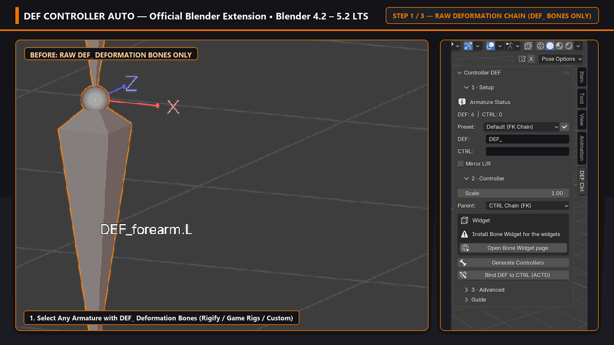
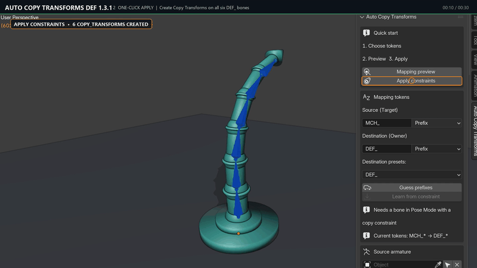
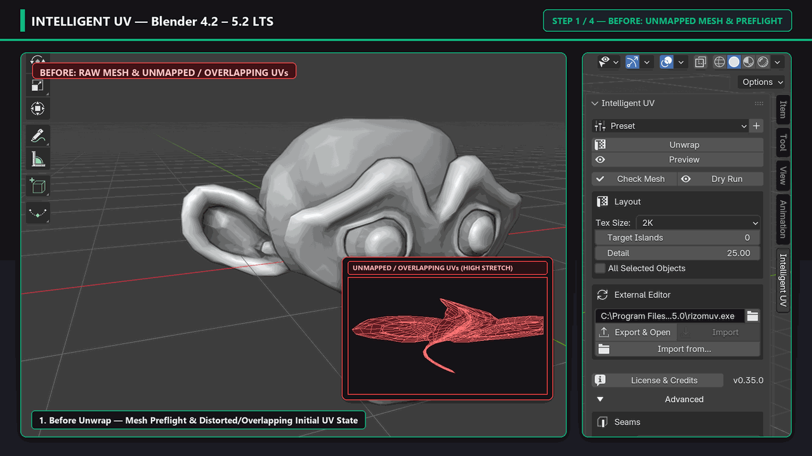

# Pierfrancesco Diodato (`PieroFra`)

> **I build production-ready Blender tools that make rigging and UV workflows faster, safer and reversible.**

CS & Game Dev Student | Aspiring Technical Artist & Blender Add-on Developer focused on rigging automation, non-destructive deformation workflows, and UV pipelines for Blender 4.2 LTS through 5.2+.

**Featured project: DEF Controller Auto (`CTRL_DEF` v0.2.0)**  
Generate production-ready FK rig controllers with shared custom shapes from `DEF_` bones in one click, with zero dependency cycles.  
[Watch the live GIF demo](#def-controller-auto-fk-controller-generation-from-a-def_-chain) · [Direct GIF](https://raw.githubusercontent.com/PieroFra/PieroFra/main/assets/def_controller_demo.gif) · [1080p MP4 video](https://raw.githubusercontent.com/PieroFra/PieroFra/main/assets/def_controller_demo.mp4) · [Install from Blender Extensions](https://extensions.blender.org/add-ons/ctrl-def/) · [Documentation](https://github.com/PieroFra/def-controller-auto#readme)

## Start Here

Not sure which add-on to try first? Pick your workflow:

- **Rigging a character from a `DEF_` skeleton?** Start with **[DEF Controller Auto](https://extensions.blender.org/add-ons/ctrl-def/)**: select your `DEF_` bones in Edit Mode and generate a clean FK controller chain in one click.
- **Wiring `MCH_` / `ORG_` / `DEF_` constraints across one or two armatures?** Pair it with **[Auto Copy Transforms DEF](https://extensions.blender.org/add-ons/auto-copy-transforms-def/)** to preview and build the entire constraint stack non-destructively.
- **Preparing meshes for baking or game engines?** Try **[Intelligent UV Mapping](https://github.com/PieroFra/intelligent_uv)** for curvature-driven seam planning, texel density normalization, UDIM packing, and an optional RizomUV bridge.

## By the Numbers

Every project here ships with a deterministic headless regression suite, published releases with SHA256 checksums, and CI-friendly verification scripts.

| Metric | Value |
|---|---|
| **Blender Compatibility** | Blender `4.2 LTS` through `5.2 LTS` (officially tested headless & GUI on 5.2 LTS) |
| **Automated Headless Verification** | **760+ checks** across the suite (`644` checks in 12 suites on A.C.T.D., `102` checks on CTRL_DEF, `14` smoke checks + `75` deterministic UI label geometry checks on Intelligent UV) |
| **Published Releases** | **11 tagged releases** with SHA256 checksums (`8` on A.C.T.D. up to `v1.3.0`, `2` on CTRL_DEF up to `v0.2.0`, `1` on Intelligent UV `v0.35.1`) |
| **Official Blender Extensions** | **2 approved & live** (`ctrl-def` and `auto-copy-transforms-def`), **0 external runtime dependencies** (100% Python stdlib + `bpy`) |

## Add-ons

<!-- AUTO-VERSIONS:START -->
| Add-on | Version | Extensions | Repo | Tracker |
|---|---|---|---|---|
| DEF Controller Auto (`CTRL_DEF`) | v0.2.0 | [Live listing](https://extensions.blender.org/add-ons/ctrl-def/) | [PieroFra/def-controller-auto](https://github.com/PieroFra/def-controller-auto) | [Issues](https://github.com/PieroFra/def-controller-auto/issues) |
| Auto Copy Transforms DEF (`A.C.T.D.`) | v1.3.0 | [Live listing](https://extensions.blender.org/add-ons/auto-copy-transforms-def/) | [PieroFra/auto-copy-transforms-def](https://github.com/PieroFra/auto-copy-transforms-def) | [Issues](https://github.com/PieroFra/auto-copy-transforms-def/issues) |
| Intelligent UV Mapping | v0.35.1 | *GitHub Release* | [PieroFra/intelligent_uv](https://github.com/PieroFra/intelligent_uv) | [Issues](https://github.com/PieroFra/intelligent_uv/issues) |<!-- AUTO-VERSIONS:END -->

### DEF Controller Auto (`CTRL_DEF` v0.2.0)

Generates tracked, color-coded FK controllers with shared custom shapes from the `DEF_` chain. Zero dependency cycles, deterministic naming, and a 1-click synergy with Auto Copy Transforms DEF for a complete controller + constraint pipeline.

### Auto Copy Transforms DEF (`A.C.T.D.` v1.3.0)

Deterministic automation of Copy Transforms / Rotation / Location / Scale constraints between a source armature (`MCH_`) and destination armatures (`DEF_`, `ORG_`). Live preview, pattern learning, and a reversible JSON registry: nothing is baked in, everything can be undone. Approved on [Blender Extensions](https://extensions.blender.org/add-ons/auto-copy-transforms-def/) and indexed on the [XERJ Corpus Hub](https://hub.xerj.org/contributors/PieroFra).

### Intelligent UV Mapping (v0.35.1)

Automated UV unwrapping driven by curvature (VSA shape clustering), seam pinning, global texel density control, UDIM multi-tile workflows, and an optional bridge with RizomUV via Live Link, Lua scripting, or full automation.

## Demos

### DEF Controller Auto: FK controller generation from a `DEF_` chain

### Auto Copy Transforms DEF: constraint automation with live preview

### Intelligent UV Mapping: curvature-driven unwrap and texel density

## Roadmap & Active Maintenance

All three projects are actively maintained with recurring verification passes:

- **DEF Controller Auto (`CTRL_DEF`)**: custom widget library presets, multi-limb batch templates, and Blender 4.2 - 5.2 LTS CI matrix.
- **Auto Copy Transforms DEF (`A.C.T.D.`)**: one-click restore operator from `actd_replace_backup_*.json` snapshots, extended multi-armature batch rules, and automated release archive validation in CI.
- **Intelligent UV Mapping**: headless end-to-end UV pipeline regression suite, clean-install gate verification on virgin Blender profiles, and Blender Extensions submission.

## Contact & Collaboration

I am open to collaborations, Python/Blender tool development, technical art pipelines, and freelance work.

- **GitHub Issues & Inquiries**: [@PieroFra](https://github.com/PieroFra) on GitHub (or open an issue on the relevant repository tracker)
- **Blender Extensions**: [CTRL_DEF](https://extensions.blender.org/add-ons/ctrl-def/) (approved & live) · [A.C.T.D.](https://extensions.blender.org/add-ons/auto-copy-transforms-def/) (approved & live) · [Author profile](https://extensions.blender.org/author/pierofra/)
- **XERJ Corpus Hub**: [hub.xerj.org/contributors/PieroFra](https://hub.xerj.org/contributors/PieroFra)
- **Reddit**: [u/Previous-Nebula7736](https://www.reddit.com/user/Previous-Nebula7736/) (release posts and workflow threads on `r/blender`)
- **ArtStation**: [artstation.com/pierofra](https://www.artstation.com/pierofra/)
